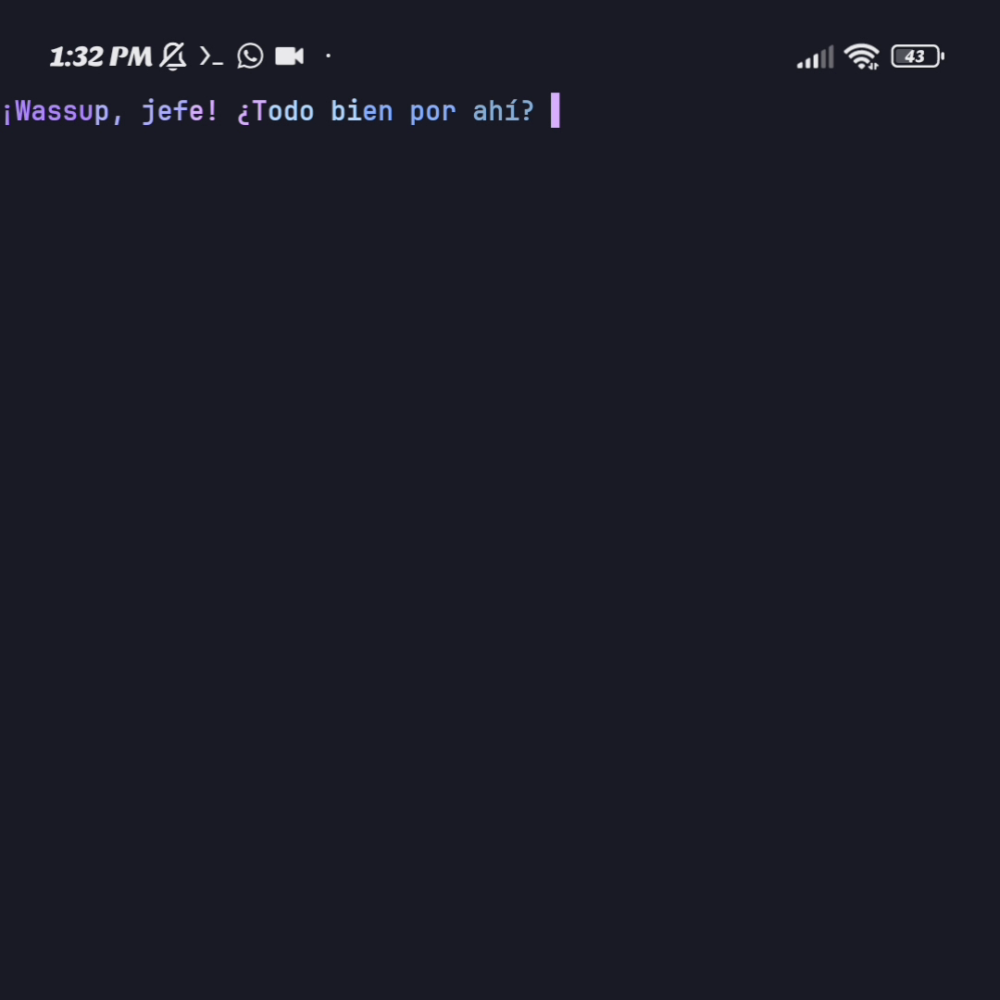
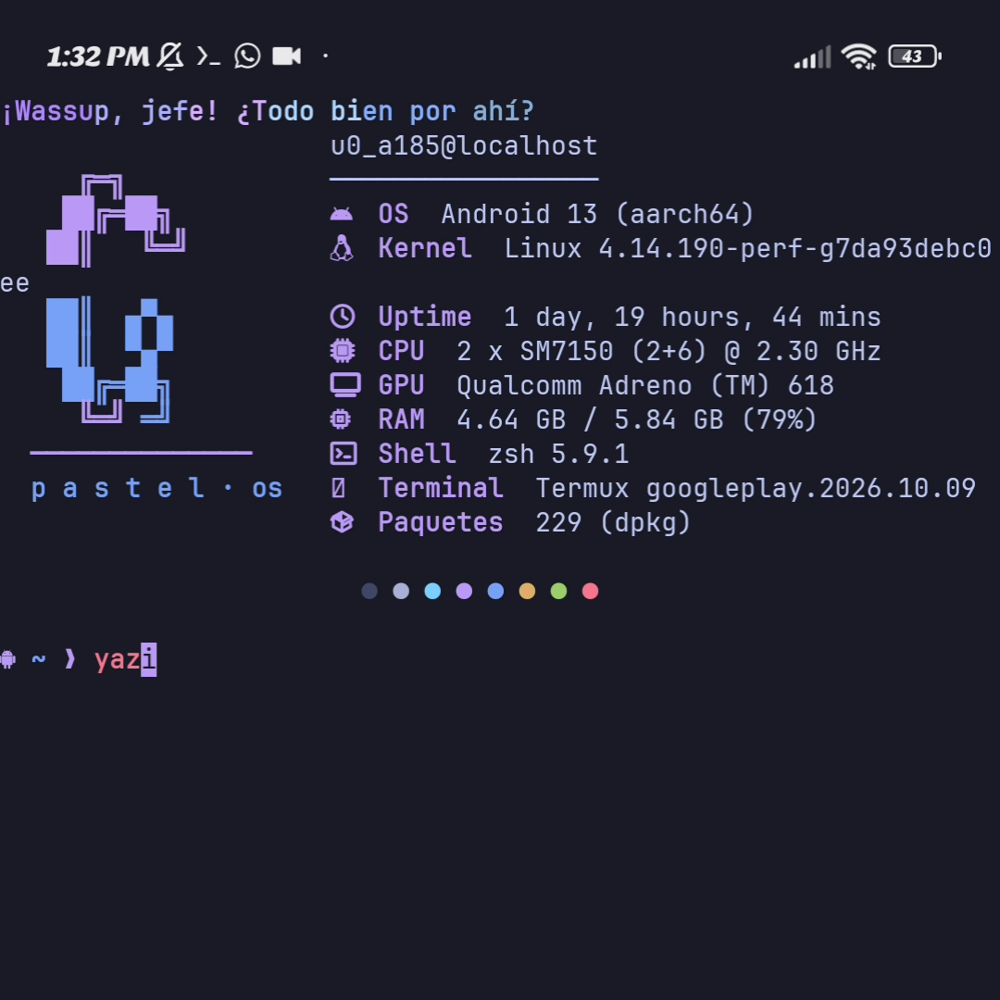
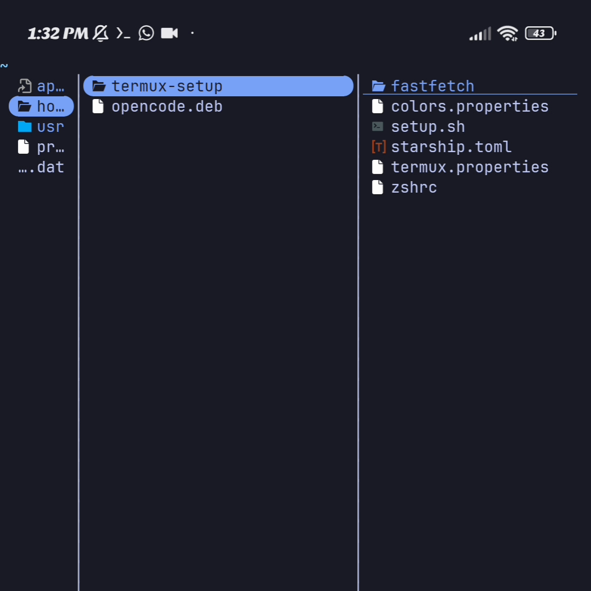
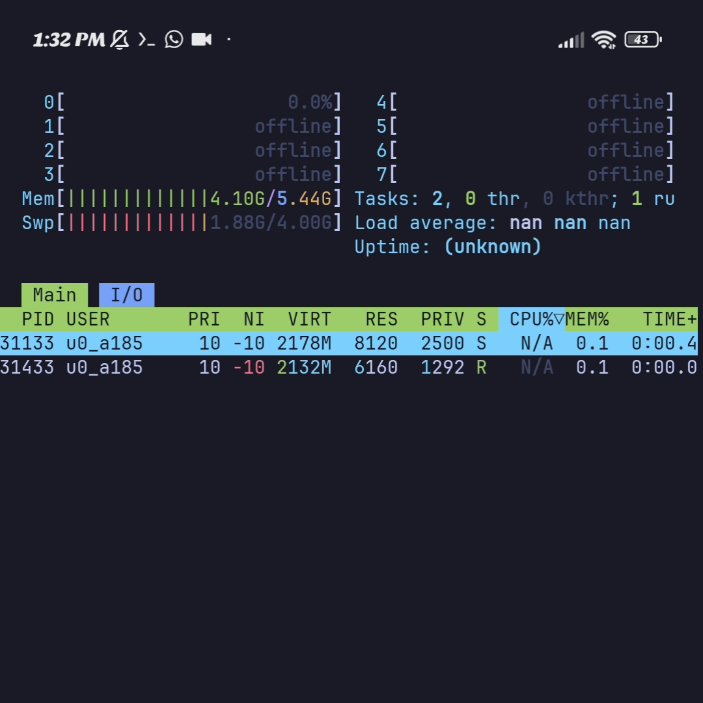

<div align="center">

<!-- Reemplaza con tu banner: sube assets/banner.png -->


# susu

**Mi personalización completa de Termux con un solo comando.**

[](https://github.com/jephersonRD/susu/releases/latest)
[](LICENSE)
[](https://termux.dev)
[](install.sh)

</div>

---

## 📖 Descripción

Repositorio con **mi setup completo de Termux**: shell zsh con prompt estilo powerline en tonos morado/azul pastel, saludo de bienvenida animado, fastfetch con arte ASCII, y las herramientas de terminal que uso a diario — todo instalable con **una sola línea** y restaurable con otra.

Hay dos ediciones:

| Edición | Incluye | Peso |
| ------- | ------- | ---- |
| **Lite** | El tema completo (zsh, starship, colores, fuente, fastfetch, htop, yazi, ssh) | ~1.4 MB |
| **Full** | Todo lo de Lite **+ opencode** listo para usar | +65 MB de descarga |

## 🕹 Uso

Al ejecutarlo verás el banner con la edición activa y el menú:

```
      My Termux Config · v0.0.4 · Lite

╭─ susu ─────────────────────────────────────────────╮
│  Instalada: v0.0.3   Disponible: v0.0.4
│  Edición: Lite sin opencode
╰────────────────────────────────────────────────────╯
  1) Instalar
  2) Actualizar
  3) Borrar (restaurar Termux)
  4) Cambiar edición (Lite/Full)
  5) Salir
```


## ⚡ Instalación

```bash
curl -fsSL https://raw.githubusercontent.com/jephersonRD/susu/main/install.sh | bash
```

- **1 · Instalar** — elige edición, instala los paquetes que falten, hace backup,
  copia las configs, aplica `~/.termux` (colores, fuente y teclas) y deja **zsh**
  como shell por defecto.
- **2 · Actualizar** — compara versiones con SemVer real y solo descarga si hay una nueva,
  manteniendo tu edición.
- **3 · Borrar** — confirmación escribiendo `si`/`yes`, backup opcional y reseteo total
  (restaura tus configs previas y nunca toca tus claves SSH privadas).
- **4 · Cambiar edición** — pasa de Lite a Full (instala opencode) o al revés.
- La primera vez pregunta el idioma y lo guarda en `~/.config/susu/lang`.
  Cámbialo cuando quieras: `bash install.sh --lang en` (o `es`).
- Puedes forzar la edición sin menú: `bash install.sh --lite` o `bash install.sh --full`.

## 🧩 Ediciones Lite y Full

**Lite** es el tema y las herramientas de siempre (lo que ya hacía susu). **Full** añade
[opencode](https://opencode.ai), el asistente de código para la terminal, con un build
**nativo bionic para Termux** publicado por la comunidad en
[Hope2333/opencode-termux](https://github.com/Hope2333/opencode-termux).

> El instalador oficial de opencode descarga binarios glibc/musl que **no funcionan en
> Android**; por eso susu usa el `.deb` nativo (aarch64/arm64) de ese proyecto y lo
> instala con `apt`. No es un paquete oficial de opencode ni de Termux.

Requisitos de la edición Full:

- Android 9+ (API 28) y arquitectura **aarch64/arm64** (en otras, susu avisa y usa Lite).
- ~400 MB libres (el paquete instalado ocupa ~275 MB).
- Al terminar, ejecuta `opencode` en la terminal y configura tu proveedor de IA
  (login o API key) la primera vez.

## 📸 Vista previa

<div align="center">
  
  
  <br/><br/>
  
</div>

### 🎬 Demo

https://github.com/user-attachments/assets/13f858ad-4784-4cd5-9140-c553d7fd5483

<sub>¿No carga el reproductor? [Abre el vídeo en el repo](assets/demo.mp4).</sub>

Al terminar, **cierra y vuelve a abrir Termux** (o abre una pestaña nueva) para entrar
en zsh. Los colores, la fuente y las teclas extra se aplican al instante con
`termux-reload-settings`.

## 🔄 Actualizar

Vuelve a ejecutar el mismo comando. El instalador:

1. Consulta la última versión publicada en GitHub.
2. La compara con la que tienes (`~/.config/susu/version`).
3. Si ya estás al día te lo dice; si hay una nueva, descarga y aplica manteniendo
   tu edición (Lite sigue en Lite, Full sigue en Full e instala opencode si faltaba).

## 📦 Qué se instala

| Paquete     | Uso                                        |
| ----------- | ------------------------------------------ |
| `zsh`       | Shell principal                            |
| `starship`  | Prompt pastel (lee `starship.toml`)        |
| `eza`       | `ls` moderno con iconos                    |
| `bat`       | `cat` con resaltado de sintaxis            |
| `fzf`       | Búsqueda difusa (historial y archivos)     |
| `zoxide`    | `cd` inteligente (`z <dir>`)               |
| `git`       | Clonar los plugins de zsh                  |
| `htop`      | Monitor de procesos                        |
| `yazi`      | Gestor de archivos TUI                     |
| `fastfetch` | Información del sistema con arte ASCII     |
| `openssh`   | Cliente/servidor SSH (`ssh` / `sshd`)      |
| `opencode`  | Asistente de código (solo edición **Full**) |

Y estas configuraciones se copian a tu `$HOME`:

| Archivo del repo             | Destino                     |
| ---------------------------- | --------------------------- |
| `config/zsh/.zshrc`          | `~/.zshrc`                  |
| `config/starship/starship.toml` | `~/.config/starship.toml`|
| `config/fastfetch/*`         | `~/.config/fastfetch/`      |
| `config/htop/htoprc`         | `~/.config/htop/htoprc`     |
| `config/yazi/yazi.toml`      | `~/.config/yazi/yazi.toml`  |
| `config/ssh/config`          | `~/.ssh/config` (modo 600)  |
| `config/termux/termux.properties` | `~/.termux/termux.properties` |
| `config/termux/colors.properties` | `~/.termux/colors.properties` |
| `config/termux/font.ttf`     | `~/.termux/font.ttf`        |

Además:

- Deja **zsh** como shell por defecto (`chsh -s zsh` → `~/.termux/shell`).
- Clona los plugins en `~/.local/share/zsh/plugins`:
  `zsh-autosuggestions`, `zsh-syntax-highlighting` y `zsh-completions`.
- Guarda la edición en `~/.config/susu/edition` (`lite` o `full`).
- En **Full**, instala opencode desde el `.deb` nativo bionic para Termux.
- `font.ttf` es **JetBrainsMono Nerd Font** (licencia OFL 2.0), necesaria para los
  iconos de `eza` y del prompt.


## 🤝 Contribuciones

¡Bienvenidas! Abre un *issue* para proponer ideas o reportar errores, o un *pull request* con tu mejora. Reglas básicas:

1. Haz *fork*, crea una rama (`git checkout -b mejora/mi-idea`) y envía el PR.
2. Sigue el estilo del código existente (comentarios, español, `set -euo pipefail`).
3. **Nunca** incluyas claves, tokens ni datos personales.
4. Actualiza el `CHANGELOG.md` en la sección `[Unreleased]`.

## 📄 Licencia

Distribuido bajo la Licencia MIT. Consulta [LICENSE](LICENSE) para más detalles.

---

<div align="center">
  Hecho con 💜 para Termux · <a href="https://github.com/jephersonRD">@jephersonRD</a>
</div>
